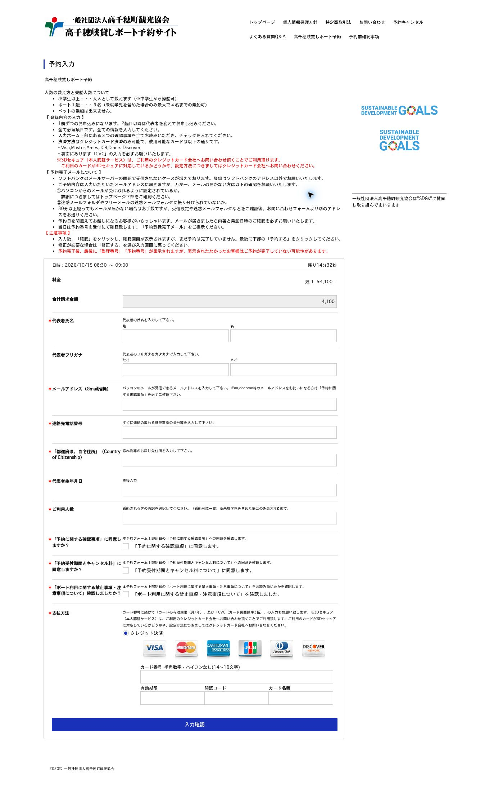

# 高千穗真實表單勘查紀錄｜2026-10-08

已透過官方正常 UI，選取一次 2026/10/15 日本時間 08:30–09:00、1 艘船，進入客戶資料表單並讀取欄位。該次顯示價格為 ¥4,100，不能套用到 10/26。勘查期間沒有填入個資、勾選同意、送出客戶資料、付款或修改 GitHub；後續經使用者授權才更新 repo。網站操作已於台北時間 08:18:54.477 停止；只建立這一次 hold。

所有下列觀察時間均為 2026-10-08、Asia/Taipei（UTC+08:00）。時間代表本次工具觀察／確認的時間，不代表伺服器釋出餘位時間。乘船時段則是日本當地時間。

| 事件 | 台北時間 | 結果與依據 |
|---|---|---|
| 第一筆有完整計時的日曆讀取開始 | 07:50:22.998 | 第一筆回應於 07:50:24.440 完成 |
| 第一個日曆候選 | 08:00:18.457 | 10/22 11:30，顯示剩 1 艘；詳情顯示「予約終了」，不可據此宣稱可預約，沒有 hold |
| 最早保存的真正可預約證據 | 08:15:04.165 | 10/22 10:00；08:15:01.664 日曆顯示剩 5 艘，詳情按鈕為啟用的「予約手続き」，沒有 click_prohibit。事後核對紀錄才辨識此狀態；當時因按鈕名稱判定過窄而錯過選取 |
| 最終選取時段的日曆觀察 | 08:17:54.818 | 10/15 08:30，剩 1 艘 |
| 最終選取時段可預約確認 | 08:17:56.293 | 詳情提供啟用的「予約手続き」，沒有 click_prohibit |
| 唯一一次預約／hold 操作開始 | 08:17:56.293 | 點擊上述按鈕一次，沒有另選時段或重試 |
| 操作返回 | 08:17:59.567 | 瀏覽器點擊操作完成；這不是擷取到的 HTTP 回應時間 |
| 成功 hold 與進入客戶表單的 UI 確認 | 08:18:05.268 | 「予約入力」、10/15 08:30–09:00、剩餘 14 分 52 秒可見。未取得獨立網路 hold 回應的時間／JSON，不杜撰 |
| 完成同一表單讀取 | 08:18:54.477 | 已停止網站操作 |

共保存 641 筆日曆讀取紀錄，其中 640 筆有完整的開始時間。相鄰開始時間間隔最短 1,157 ms、中位數 1,297 ms、平均 2,582.975 ms、最長 180,013 ms。網站回應與工具檢查造成延遲及中斷，因此沒有達到精準每秒一次，也不能宣稱整段無中斷。前一次未完成時沒有重疊或補發。641 是 UI 日曆讀取紀錄數，並非 HTTP request 數；日期操作也可能讀取假日等公開資料。原訂截止為 08:20，成功取得一份表單後依授權提早停止。未觀察到畫面顯示 CAPTCHA 或頻率限制；未逐筆擷取 HTTP status，不能宣稱完全沒有 429。

官方說明：選取時段後會扣除船位，15 分鐘內未完成付款即失效，船位重新顯示。本次依倒數推估約台北時間 08:33 到期，但未觀察到伺服器實際釋放，不把關閉瀏覽器當成立即釋放。沒有操作已完成預約的取消功能。官方規則來源：[官方首頁使用說明](https://eipro.jp/takachiho1/terms/view/toppage)。

已確認的客戶欄位如下。除總額欄有 id，其餘 9 個可填客戶欄位沒有 id，均以當次唯一的 name selector 定位。全部 enabled、非 readOnly；總額例外為 readOnly。所有欄位 DOM 的 required 都為 false、aria-required 未提供，但頁面說明要求全部資訊，且姓名、Email、電話、地址、生日、人數有必填星號。片假名無星號，是否在伺服器端必填仍待驗證。不能以 required=false 解讀成可不填。

| 資料 key／可見標籤 | 真實唯一 selector | 類型／mapping | 已確認限制 |
|---|---|---|---|
| familyName／代表者氏名：姓 | `input[name="data[Customer][l_name]"]` | text／fill | 姓與名分開 |
| givenName／代表者氏名：名 | `input[name="data[Customer][f_name]"]` | text／fill | 不可只 mapping 一個完整姓名 |
| familyNameKana／代表者フリガナ：セイ | `input[name="data[Customer][l_name_kana]"]` | text／fill | 文字要求片假名 |
| givenNameKana／代表者フリガナ：メイ | `input[name="data[Customer][f_name_kana]"]` | text／fill | 文字要求片假名 |
| email／メールアドレス（Gmail推奨） | `input[name="data[Customer][mail]"]` | email／fill | title 要求 Email 格式；官方建議 Gmail、避開 SoftBank |
| mobilePhone／連絡先電話番号 | `input[name="data[Customer][mobile_tel]"]` | tel／fill | title 要求 0–9 與連字號；海外號碼格式待確認 |
| address／「都道府県、自宅住所」（Country of Citizenship） | `input[name="data[CustomerQuestionAnswer][4][answer]"]` | text／fill | 說明要求寄回遺失物的住家地址；英文標籤與日文含義有差異，海外填法待確認 |
| birthDate／代表者生年月日 | `input[name="data[Customer][birth_date]"]` | text／fill | inputmode=numeric，class 含 js-format--dateEx；精確輸入格式與格式化行為待 Mac 驗證 |
| passengerComposition／ご利用人数 | `select[name="data[CustomerQuestionAnswer][6][answer]"]` | select／select | 選項 value 就是日文選項文字；single select |
| 系統計算總額／合計請求金額 | `#order_detail_total_billing` | text／禁止 fill | name=`data[OrderDetail][billing_price]`，readOnly=true |

8 個客戶 input 的 autocomplete 均為 off；人數 select 未提供 autocomplete。未觀察到 maxlength、minlength、pattern、min、max、step 屬性，這只表示 HTML 未暴露限制，不代表伺服器沒有檢核。customer inputs 沒有原生連結的 label、aria-label 或 placeholder，畫面上的名稱主要是旁邊文字。完整 metadata 在隨附 audit JSON。沒有讀取輸入框中個資值、Cookie 值、token 或已填付款資料。

人數 select 的全部 16 個選項如下；text 與 value 相同、皆非 disabled。第 1 個為空值，正式填寫必須選非空選項。日文的全形數字、半形 `1` 及標點需保留。

| option text | option value |
|---|---|
| 空白 | `""` |
| 大人１名 | `大人１名` |
| 大人２名 | `大人２名` |
| 大人３名 | `大人３名` |
| 大人１名、未就学児1名 | `大人１名、未就学児1名` |
| 大人１名、未就学児２名 | `大人１名、未就学児２名` |
| 大人１名、小学生１名 | `大人１名、小学生１名` |
| 大人１名、小学生２名 | `大人１名、小学生２名` |
| 大人１名、小学生１名、未就学児１名 | `大人１名、小学生１名、未就学児１名` |
| 大人１名、小学生１名、未就学児２名 | `大人１名、小学生１名、未就学児２名` |
| 大人１名、小学生２名、未就学児１名 | `大人１名、小学生２名、未就学児１名` |
| 大人２名、未就学児１名 | `大人２名、未就学児１名` |
| 大人２名、未就学児２名 | `大人２名、未就学児２名` |
| 大人２名、小学生１名 | `大人２名、小学生１名` |
| 大人２名、小学生１名、未就学児１名 | `大人２名、小学生１名、未就学児１名` |
| 大人３名、未就学児１名 | `大人３名、未就学児１名` |

三個確認 checkbox 都保留未勾選，名稱皆為 `data[dummy]`，所以不能以 name 唯一定位。各有當次唯一 UUID id，但跨次穩定性未驗證；只可當作這次 DOM 證據，不應寫進自動同意的 mapping。

| checkbox 可見選項／value | 當次 id |
|---|---|
| 「予約に関する確認事項」に同意します。 | `6ac6e136-a6d8-44fb-b73a-0eb2c0a801aa` |
| 「予約受付期間とキャンセル料について」に同意します。 | `6ac6e136-a524-4ce1-84f3-0eb2c0a801aa` |
| 「ボート利用に関する禁止事項・注意事項について」を確認しました。 | `6ac6e136-26b0-4452-98e7-0eb2c0a801aa` |

付款 UI 與信用卡欄位同時出現在表單，不是到最後頁才出現；這次未填寫或操作付款欄位，也未擷取付款 token。它們應全部列為人工處理。沒有觀察到需切换人數後才出現的額外客戶欄位；本次未改動任何客戶 control，因此無法證明所有動態分支。`入力確認` 及後續最終預約、付款、3D Secure 均未操作。

已確認正常流程是：官方首頁 → 日曆 → 日視圖與日期 → 點選具體時段，開啟只讀詳情 → 確认可用的「予約手続き」 → 唯一一次 hold → `orders/add` 客戶頁。官方當次 inline constants 為 POPUP=1、ORDER=2、DETAIL=3，所以 calendar action type 1 的第一次點擊是詳情 popup。不能把每次日曆點擊直接計作 hold；也不能據此任意把 repo 的 type 1 改成 type 2，repo 的直接 hold adapter 仍需驗證。官方 rendered「予約手続き」與「予約終了」是本次使用的可操作狀態依據；DOM 讀取範圍未提供完整 raw event flags，沒有僅憑 remaining>0 建立 hold。

對照勘查當時 main（0417ce708031e12cc00ce3ec3d54f10e4e5f90b8）的問題如下；這是歷史問題清單，欄位辨識、必要欄位、設定與 receipt 已在本次 repo 更新修正，Mac／伺服器驗證仍待完成：

1. 勘查當時 `discoverCustomerForm` 只從原生 labels／ARIA／placeholder 取 label，因此姓名、地址、人數等顯示名稱會是空字串。地址與人數的 `CustomerQuestionAnswer` 名稱無法命中當時的 customer regex，兩個 mapping 會被拒絕。這次已加入周邊欄位標籤及經確認的特定欄位契約，沒有放寬成允許所有未知欄位。
2. required 全是 false。只依 required／HTML validity 可能在漏填官方必填欄位時仍產生 customerFieldsVerified=true。應明確驗證已確認的必要客戶欄位及非空人數；伺服器規則仍需人工確認，不能以本次未提交勘查宣稱已驗證。
3. 第三個 checkbox 沒有「同意」而是「確認」，勘查當時的 FINAL_CONFIRMATION regex 可能分類為 unsupported；這次已補強文字及 `data[dummy]` 防護，三個確認仍須人工處理。
4. 姓名須拆為姓／名，片假名也須拆為セイ／メイ。`representativeName` 是 config 的代表人識別資料，不應當作一個不存在的完整姓名欄位；若把它留在 fields 卻沒有 mapping，程式會回報 missingMappingKeys。
5. `fill` 僅適用 8 個 input；人數必須 `select` 並使用真實 value。`check` 語法雖接受字串 true／false，這份表單沒有適合自動 check 的客戶選項；三個確認與付款全部人工。
6. 生日可能在 blur 時格式化；現有 inputValue 與原字串完全相等的驗證需在 Mac 確認。台灣電話／地址、片假名及日期格式，本次沒有填入資料或提交，仍待確認。
7. 客戶頁的 read-only 資源、付款 iframe 與 safety allowlist 必須在 Mac 實際載入檢查 blocked 診斷。不能用放行所有第三方或未知 POST 解決，也未確認其付款能力。
8. 本次輪詢的初版只認「予約」，漏掉實際「予約手続き」，已在本次勘查中修正；GitHub 未修改。後續 UI 程式須以實際狀態辨識按鈕、重新核對可預約及截止時間，再維持單次 hold 防護。

更新後的 `config/config.example.json` 已包含 10:00 與 10:30 每船 9 個實際 mappings，個資值都是空白。將它複製至本機 `config/config.local.json` 再填自己的資料；已有 local 檔時手動合併，避免覆寫。程式透過 observed-form profile 辨識地址／人數，分開輸出 htmlRequired 與本機有效 required；9 個客戶值須完整、非空且符合目前 DOM。三個確認與付款仍人工，receipt v2 必須由 Mac full-rehearsal 實際填寫驗證產生。這次只讀到 08:30 的一份表單，因此是否與正式 10:00／10:30 完全一致也仍待 Mac 確認。沒有替正式兩船建立 hold。

兩船應各自準備不同真實代表人的完整姓名、拆分姓／名、片假名姓／名、可收確認信的 Email、可即時聯繫的電話、住家地址、生日及各船乘客組成。官方一艘通常 3 人，含未就學兒童才可最多 4 人，小學生以上的計數依當次選項與規則；中學生起才可操船。實際分船組合須自行確認，不根據家庭記憶擅自填值。另需自行準備信用卡與 3D Secure、閱讀三項確認事項，以及最後確認／付款。此清單只是正式操作前準備，不延伸本次代操作授權。

本次是真站表單解析，不是 Mac Autofill 驗證。尚未執行本機 full-rehearsal 的填寫與逐欄比對，也沒有產生或偽造 `.local/form-verification.json`。本機流程仍須依 [MAC_CHECKLIST.md](https://github.com/Zhong-627/takachiho-sniper/blob/main/docs/MAC_CHECKLIST.md) 在另一次明確授權的單次 full-rehearsal 中取得同一客戶頁、更新 local config，於 CLI 輸入 `f` 重新載入並驗證，不重新 hold；只有真實 customerFieldsVerified 才能更新 receipt。readiness 要求兩個 slot 的 mappings 與欄位 keys 簽章相符、驗證在 live 前 7 天內；最後跑 doctor。不要手寫 receipt 或繞過 readiness。

正式 2026/10/26 的釋出是 2026/10/12 台北 08:00／日本 09:00。本次沒有进入 10/26 客戶表單，也不證明正式釋出當下餘位、Mac 環境或付款會成功。

以下來源是勘查當時 GitHub plugin 讀取的 main 快照 `0417ce708031e12cc00ce3ec3d54f10e4e5f90b8`。SHA 是檔案 blob SHA，不是 commit SHA；勘查期間未提交 commit、PR 或 issue。

| 來源 | blob SHA |
|---|---|
| [src/autofill.ts](https://github.com/Zhong-627/takachiho-sniper/blob/0417ce708031e12cc00ce3ec3d54f10e4e5f90b8/src/autofill.ts) | `52e9805b11bb091c0497476982628824edd47fff` |
| [config/config.example.json](https://github.com/Zhong-627/takachiho-sniper/blob/0417ce708031e12cc00ce3ec3d54f10e4e5f90b8/config/config.example.json) | `15a52e00dc0a50df007926fdbd9492176909402d` |
| [src/readiness.ts](https://github.com/Zhong-627/takachiho-sniper/blob/0417ce708031e12cc00ce3ec3d54f10e4e5f90b8/src/readiness.ts) | `f691f33ebbe3e7d99e403d0cd0fc6bd90a83460b` |
| [docs/REAL_SITE.md](https://github.com/Zhong-627/takachiho-sniper/blob/0417ce708031e12cc00ce3ec3d54f10e4e5f90b8/docs/REAL_SITE.md) | `23ea3f0ee4566243eed543a32f00b5c49f08f4a2` |
| [docs/MAC_CHECKLIST.md](https://github.com/Zhong-627/takachiho-sniper/blob/0417ce708031e12cc00ce3ec3d54f10e4e5f90b8/docs/MAC_CHECKLIST.md) | `024907195cef007699e1f1ee99927558e6fcaceb` |

另外使用官方公開載入的 [order module](https://eipro.jp/module/Front/js/app.module.front.order.js) 核對 popup 與 reserve 分工。官方入口與規則：[首頁](https://eipro.jp/takachiho1/terms/view/toppage)、[預約日曆](https://eipro.jp/takachiho1/eventCalendars/index)。本次客戶頁與倒數的已保存截图供核對；不提供含 session 的 action URL。

已保存的原始可見欄位與時間證據：[metadata JSON](evidence/customer-form-20261008.json)。離線 fixture 是依 metadata 重建，不是下載的完整 HTML，也不包含網站的生日格式化程式，不能拿來證明伺服器或真站 Autofill 成功。

